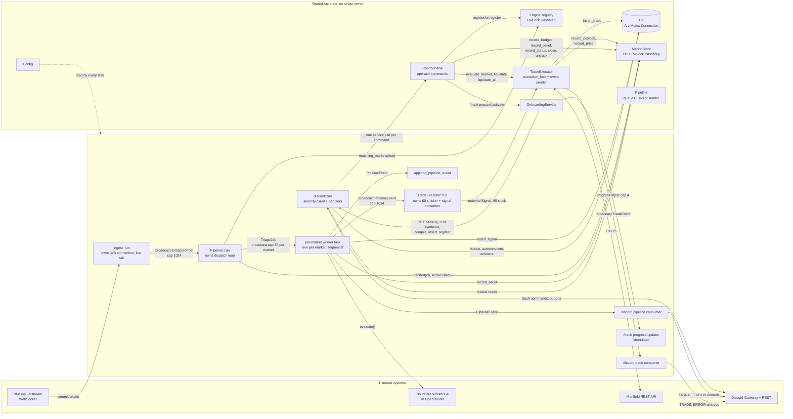
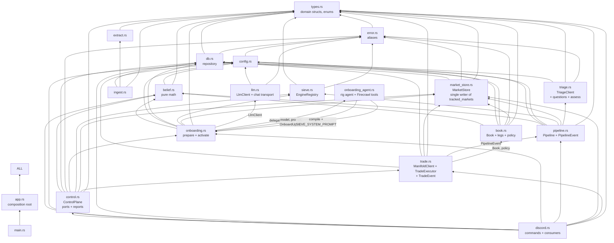
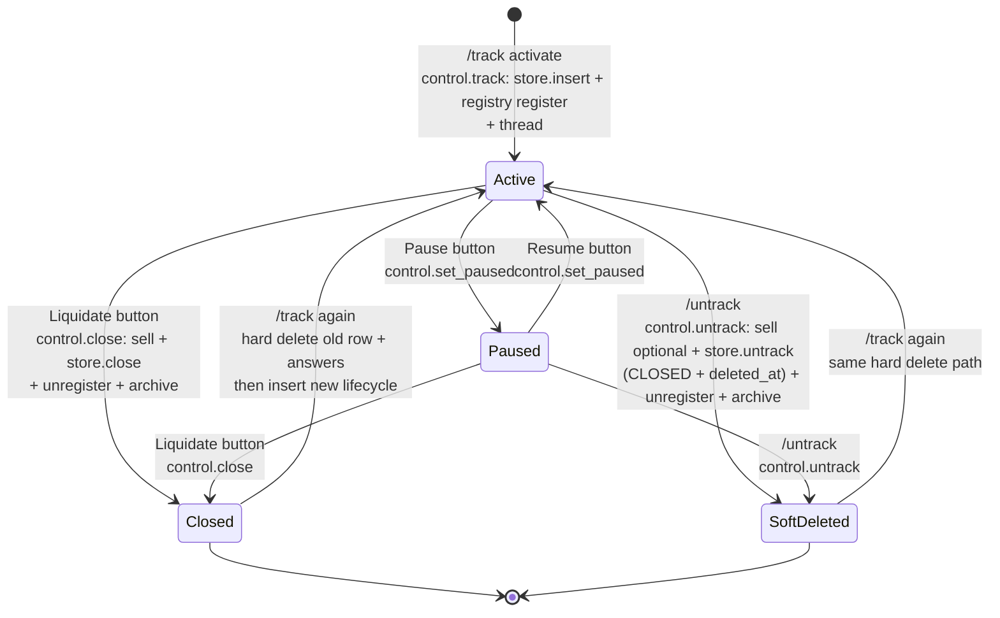
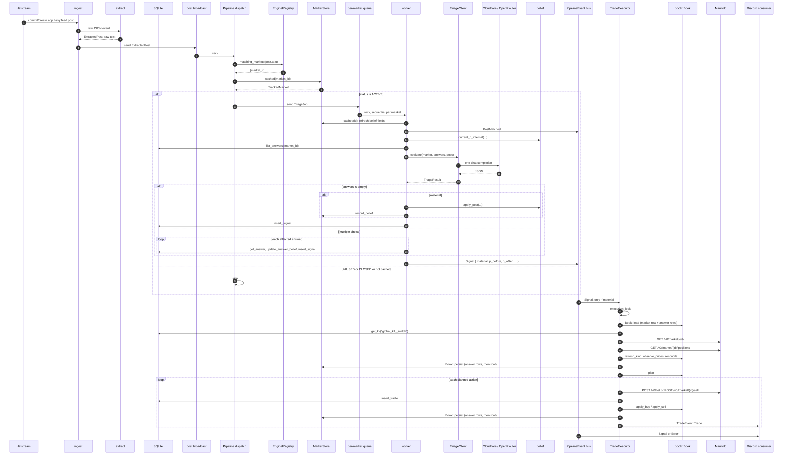
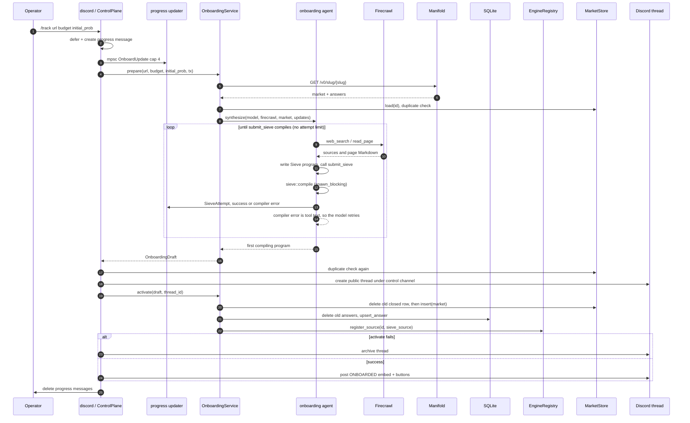
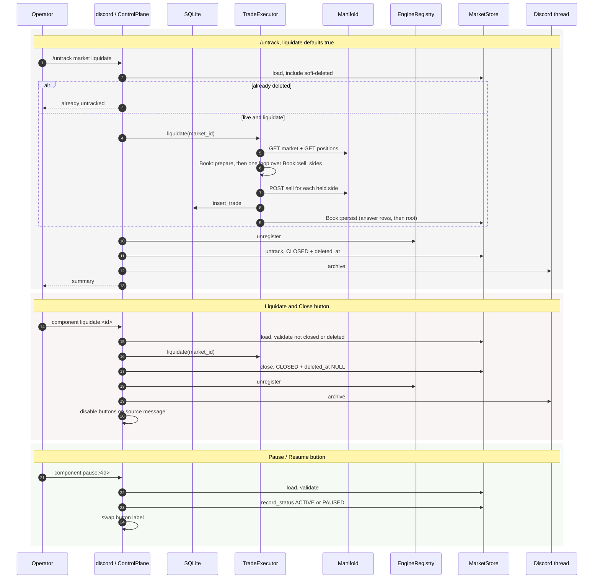
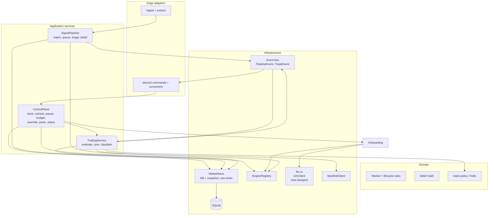

# Architecture map — detailed enough to plan a restructure

This describes the code as it is **today**. Each box maps to a Rust module. Each
arrow is a real call or channel. Line references point to the current source.

---

## 1. Runtime topology: tasks, shared state, channels



Key point for restructuring: the composition root is now `app::App`. `build`
constructs every shared `Arc` and service, `spawn` subscribes every receiver and
starts the tasks, and `Tasks::run` owns the aborts. It is a root, not a service
locator: its fields are private, `spawn` consumes it, and nothing reads them
afterwards. Shared state is still a set of independent `Arc`s passed into
constructors, so any module can hold any other module's state.

### Task inventory

| Task | Spawned in | Lifetime | Owns | Ends when |
|---|---|---|---|---|
| `ingest::run` | `app.rs` (`App::spawn`) | process | WS stream, `post_tx` | Ctrl-C (`abort`) |
| `Pipeline::run` | `app.rs` (`App::spawn`) | process | `post_rx`, dispatch loop | Ctrl-C |
| per-market worker | `pipeline.rs:433`, lazily | process, detached | `TriageJob` receiver, queue depth | sender dropped / Ctrl-C |
| `TradeExecutor::run` | `app.rs` (`App::spawn`) | process | pipeline event receiver, 60 s ticker | Ctrl-C |
| `discord::run` | `app.rs` (`App::spawn`) | process | gateway client, handlers | gateway error / Ctrl-C |
| pipeline consumer | `discord.rs:115` | process | `PipelineEvent` receiver | channel closed |
| trade consumer | `discord.rs:121` | process | `TradeEvent` receiver | channel closed |
| logger | `app.rs` (`App::spawn`) | process | `PipelineEvent` receiver | channel closed |
| `/track` updater | `discord.rs:717` | one command | `OnboardUpdate` receiver, progress message | sender dropped |

Every mutating command is now one [`control::ControlPlane`] call. Only `/status` and
autocomplete still read the store and the database directly; they cannot write, so
they cannot make two stores disagree.

---

## 2. Module dependency graph: who imports whom



### Dependency observations that matter for restructuring

1. **No module cycles.** The graph is acyclic. `pipeline` does not import `trade`,
   and `trade` does not import `discord`. This is good news: you can split modules
   without breaking a cycle.
2. **`pipeline.rs` used to hold a third module.** `MarketCache` lived there and
   was used by `trade`, `onboarding`, `discord`, and `main`, which is why those
   modules imported `pipeline`. Market state now lives in `market_store.rs`, so
   `pipeline.rs` is only `Pipeline` (orchestration and per-market queues) plus
   `PipelineEvent`. `trade.rs` and `onboarding.rs` still import `pipeline` for the
   event type and nothing else.
3. **`trade.rs` has two entry points.** It consumes `PipelineEvent` in `run()` and
   exposes `evaluate_market()`, `sync_market()`, `liquidate()`, `liquidate_all()`
   directly to Discord. It is both a subscriber and a service.
4. **`book.rs` is one-way.** `trade` imports `book` for the position model,
   accounting, and policy; `book` never imports `trade`. It depends on `types`,
   `db`, `market_store`, `belief`, `config`, and `error` only, so the trading
   rules are testable without the HTTP client.
5. **The chat transport is its own leaf.** `onboarding.rs` imports `LlmClient`
   from `crate::llm`. `triage.rs` imports nothing from `llm`, because triage is a
   decision model that reaches OpenRouter's decisions endpoint through
   `rig::typesafeai`; the two modules are peers, not parent and child. `llm`
   depends only on `config`, `error`, and `rig`, so the transport can be read
   without knowing a domain type.
   `onboarding.rs` and `onboarding_agent.rs` form one deliberate pair: the
   service prepares and activates a draft and delegates the model run, while the
   agent owns the tools and imports the prompt, market type, and progress events
   from the service. The import edge goes both ways, but it is one workflow, not
   two features.
6. **`control.rs` is the command seam.** Every mutating Discord handler calls
   one `ControlPlane` method; `discord.rs` keeps only presentation and the
   `/status` read path. The edge is one-way (`discord → control`), so the
   service can be tested in-process without the Discord client.
7. **`types.rs` is a shared kernel.** All modules depend on it, and it contains both
   pure domain values (`TrackedMarket`, `Direction`) and workflow payloads
   (`TriageResult`, `TradeDecision`, `SignalRecord`). This is acceptable, but a
   change to a ledger struct touches many modules.

---

## 3. State ownership and sources of truth

This is the most important section for restructuring. Several facts live in
**two or three places at once**: the row, a snapshot of it, and sometimes a
third store such as `EngineRegistry` or Manifold itself.

| Fact | Authoritative store | Mirrors | Writers | Readers |
|---|---|---|---|---|
| Market lifecycle `status` | `tracked_markets.status` | `MarketStore` snapshot | `control` (pause, resume, close, untrack), `insert` (onboarding) | dispatch, trade, `/status`, autocomplete |
| Presence of a Sieve engine | `EngineRegistry` map | none | `app` startup, onboarding.activate, onboarding rollback, `control` teardown | dispatch |
| Compiled rule text | `tracked_markets.sieve_source` | none | onboarding.activate | `/status` embed |
| Budget `budget_mana` | `tracked_markets` | `MarketStore` | `control::set_budget`, `insert` | trade, `/status` |
| Position `invested_mana`, `realized_pnl_mana`, `yes_shares`, `no_shares` | `book::Book` legs; answer rows hold a multiple-choice leg, root columns the binary leg | `MarketStore` | `Book::apply_buy`, `Book::apply_sell`, `Book::reconcile`; `Book::persist` writes answer rows then the root | trade, `/status` |
| Belief `p_internal_log_odds`, `belief_updated_at` | `tracked_markets` and `market_answers` | `MarketStore` (market only) | `record_belief` (pipeline, `control::set_probability`), `insert` | pipeline, trade, `/status` |
| Market price `p_market_last` | Manifold `/v0/market` | `tracked_markets` + `MarketStore` | `record_price` (trade sync only) | triage prompt, trade, `/status` |
| Market kind `outcome_type`, `should_answers_sum_to_one` | `tracked_markets` | `MarketStore` | `record_kind` (trade sync) | trade, `/status` |
| Position truth | Manifold `/v0/market/{id}/positions` | local shares + invested | `trade.prepare` → `Book::reconcile` | trade, `/status` |
| Global kill switch | `kv.global_kill_switch` | none | `control::panic` | trade.evaluate_market |
| Signal history | `signal_ledger` | none | pipeline worker | `/status` |
| Trade history | `trade_ledger` | none | trade | `/status` |
| Discord thread per market | `tracked_markets.discord_thread_id` | `MarketStore` | onboarding.activate (via `/track`) | embed consumers, `/untrack`, Liquidate |
| In-flight triage count | `QueueDepth` AtomicUsize | none | pipeline enqueue/dequeue | `/status` |

### One writer per column group

`Db` has no market methods at all. Every read and write of `tracked_markets`
goes through `MarketStore`, which exposes one intent per column group
(`record_belief`, `record_price`, `record_position`, `record_status`,
`record_budget`, `record_kind`) plus the lifecycle transitions (`insert`,
`close`, `untrack`, `delete`). Each intent writes SQLite first and then patches
only its own fields in the snapshot; if the row write fails, the snapshot is
left untouched.

Belief and price are separate intents on purpose. Decay reads the current price
as a parameter, so a newer price next to an older `belief_updated_at` is the
intended model. A writer that carried both groups could revert a belief (or a
pause) from a snapshot taken before an HTTP call. The pipeline and `/override`
therefore never touch `p_market_last`; the 60-second trade sync is its only
writer.

### One writer for operator lifecycle transitions

`control::ControlPlane` is the only writer of an operator-driven lifecycle
transition (`untrack`, `close`, pause/resume) and the only caller of
`EngineRegistry::unregister` outside onboarding's own rollback. That makes
"status, `deleted_at`, and engine membership cannot disagree" a property of one
module rather than a convention seven handlers must remember.

Both teardowns go through one private `teardown(market, end, threads)` body. The
end state is a value, and the failure order is the only deliberate divergence:

| Step | `End::Hide` (`/untrack`) | `End::Keep` (Liquidate button) |
|---|---|---|
| 1. unregister the engine | yes | after the row write |
| 2. write the row | `MarketStore::untrack`; a failure is propagated | `MarketStore::close`; a failure is logged |
| 3. unregister the engine | — | yes |
| 4. archive the thread | only when step 2 succeeded | always |

`/untrack` leaves `CLOSED` + `deleted_at`; the button leaves `CLOSED` with
`deleted_at` NULL. `Book::persist` remains the only position writer, and the
control plane never writes a position column.

### One writer for the position aggregate

`book::Book` adds one layer of ownership above `MarketStore`. A market owns one
**leg** per position: a binary market has exactly one leg without an answer ID,
a multiple-choice market has one leg per answer row. The root
`invested_mana`/`yes_shares`/`no_shares` columns are always the **sum of the
legs**, derived on demand by `Book::aggregate`; no caller increments them.

`Book::persist` is the only code that writes a position: it updates the answer
rows first and the root row after, through `MarketStore::record_position` and
`Db::update_answer_position`. `trade.rs` and `discord.rs` never write a position
column, so the five hand-maintained aggregate updates that used to live in the
executor cannot drift apart again. `realized_pnl_mana` has no per-answer column,
so it stays a single value on the market row; a sell on any leg adds to it.


### Lifecycle state machine (three stores must agree)



Rules encoded only by convention, not by a type:

- A **paused** market keeps its engine. `dispatch` matches it, then skips it because
  `MarketStore::cached` returns `PAUSED`. So "registered" does not mean "live".
- A **closed** market may or may not have `deleted_at`. `/untrack` sets both. The
  Liquidate button sets `CLOSED` only. `MarketStore::list` hides only soft
  deletes, so a closed-but-tracked market still appears in `/status` and
  autocomplete.
- Re-`/track` on a `CLOSED` row hard-deletes the row and answers, then inserts a new
  one. The ledgers keep the old history.
- Position reconciliation can change shares/invested **without** a trade.
  `sync_market` writes them from Manifold every 60 s, through `Book::persist`.

### Multi-step writes with no shared transaction

| Operation | Steps | Failure handling |
|---|---|---|
| `onboarding.activate` | delete old closed row + answers → `store.insert` (row and snapshot) → insert answers → register engine | manual rollback of answers, market row, and engine; the snapshot entry goes with the row |
| `/track` (`ControlPlane::track`) | prepare (read only) → create Discord thread → activate → post embed | archive thread if activate fails; post failure is logged only |
| `/untrack` (`ControlPlane::untrack`) | resolve row → liquidate → `End::Hide` (unregister → `store.untrack` → archive) | liquidation error does not abort cleanup; a `store.untrack` error aborts before archiving; archive failure is logged only |
| Liquidate button (`ControlPlane::close`) | check status → `executor.liquidate` → `End::Keep` (log a `store.close` error → unregister → archive) → disable buttons | each cleanup step is best effort; a sell error still closes the market |
| Pause button (`ControlPlane::set_paused`) | read row → validate → `store.record_status` → edit buttons | one call; the row and the snapshot cannot diverge |
| `/override` (`ControlPlane::set_probability`) | compute logit → `store.record_belief` → `check_now` | trade check is fire-and-forget; errors are logged only |

These are the main **consistency seams**. The mutating commands now share one
`ControlPlane` saga with explicit compensation; `/status` stays a read-only
adapter path.

---

## 4. Interface contracts

The current public API, grouped by module. These are the seams you can move.

### `db.rs`

```rust
#[derive(Clone)]
pub struct Db { conn: Arc<Mutex<Connection>> }

Db::open(path) -> AppResult<Db>
Db::open_in_memory() -> AppResult<Db>

// no market rows: see market_store.rs

Db::insert_signal(&SignalRecord) -> i64
Db::recent_signals(id, limit) / latest_signal_time(id)
Db::insert_trade(&TradeRecord) -> i64 / recent_trades(id, limit)

Db::upsert_answer(&TrackedAnswer) / list_answers(id) / get_answer(market_id, id)
Db::update_answer_belief(...) / update_answer_shares(...)
Db::delete_answers_for_market(id)

Db::get_kv(key) / set_kv(key, value) / delete_kv(key)
```

All calls are **synchronous** and hold the single connection mutex. Callers use
them from async tasks but never hold the guard across `.await`.

`Db::lock`, `ensure_updated`, and `invalid_text` are `pub(crate)` because
`market_store.rs` shares the connection and the same row-mapping conventions.

### `market_store.rs`

```rust
pub struct MarketStore {
    db: Db,
    markets: RwLock<HashMap<MarketId, TrackedMarket>>,
}

MarketStore::new(&Db) -> AppResult<Self>          // live snapshot

MarketStore::cached(id) -> Option<TrackedMarket>
MarketStore::active() -> Vec<TrackedMarket>       // sorted by id
MarketStore::active_count() -> usize

MarketStore::load(id) -> AppResult<Option<TrackedMarket>>   // includes soft-deleted
MarketStore::list() -> AppResult<Vec<TrackedMarket>>        // excludes soft-deleted
MarketStore::list_including_deleted() -> AppResult<Vec<TrackedMarket>>

MarketStore::insert(&TrackedMarket)
MarketStore::close(id)                            // CLOSED, deleted_at NULL, cache remove
MarketStore::untrack(id, at)                      // CLOSED + deleted_at, cache remove
MarketStore::delete(id)                           // hard delete, cache remove

MarketStore::record_status(id, MarketStatus)      // Active or Paused only
MarketStore::record_budget(id, budget_mana)
MarketStore::record_belief(id, log_odds, updated_at)
MarketStore::record_price(id, p_market)
MarketStore::record_position(id, invested, realized_pnl, yes_shares, no_shares)
MarketStore::record_kind(id, outcome_type, sum_to_one)
```

`MarketStore` is the only path to `tracked_markets`. Every method is
synchronous: it takes the connection guard, releases it, then patches the
snapshot under its own lock, so no lock is held across an `.await`. An intent
never inserts into the snapshot; a late write to an untracked market updates the
row and leaves the snapshot alone. See the module docs for the column-ownership
table.

### `sieve.rs`

```rust
pub struct EngineRegistry { engines: RwLock<HashMap<MarketId, CompiledSieve>> }

EngineRegistry::new()
register(id, CompiledSieve)
register_source(id, &str) -> AppResult<()>   // compiles then inserts
unregister(id) -> bool
matching_markets(text) -> Vec<MarketId>
market_ids() / len() / is_empty() / contains(id)
sieve::compile(source) -> AppResult<CompiledSieve>
```

### `belief.rs`

Pure functions, no I/O:

```rust
current_p_internal(l_stored, updated_at, p_market, now, halflife) -> f64
apply_post(&mut l_stored, &mut updated_at, direction, strength, p_market, now, kappa, halflife) -> impulse
sigmoid(log_odds) / logit(p) / override_probability(p) -> (log_odds, p)
```

### `llm.rs`

Chat transport only: provider construction and completion models, built on the
vendored `rig`.

```rust
const LLM_CONNECT_TIMEOUT: Duration = Duration::from_secs(20)
const LLM_READ_TIMEOUT: Duration = Duration::from_secs(45)
const ONBOARDING_REQUEST_TIMEOUT: Duration = Duration::from_secs(120)

pub struct LlmClient { cloudflare: Option<...>, openrouter: Option<...> }

LlmClient::new() -> AppResult<Self>              // reads env through rig providers
LlmClient::completion_model(model) -> rig::DynModel<rig::operation::Completion>

chat_transport(total) -> AppResult<rig::http_client::ReqwestClient>   // private
```

`chat_transport` builds the one `reqwest` client both providers share. It sets a
20 s connect timeout, a 45 s read timeout, and a total deadline (120 s for an
onboarding turn). The total deadline is the one that ends a stalled streamed
turn: OpenRouter holds a queued request open with `: OPENROUTER PROCESSING`
comment lines, and every comment is a read that resets the read timeout.

`onboarding.rs` is the only consumer. `triage.rs` is a decision model and has no
edge to this module. The module doc states what must not move in: prompts,
response parsers, retries, and feature logic belong to the feature module that
needs them.

### `triage.rs`

The decision model: four typed questions to OpenRouter's
`POST /api/alpha/decisions`, through `rig::typesafeai`.

```rust
pub enum Polarity { Yes, No }
pub enum EvidenceLevel { Noise, Weak, Strong, Definitive }
pub enum Target { Binary, Answer(String), NoAnswer }
pub struct TriageOutcome { p_evidence, p_target, alternatives, strength,
                           p_priced, target, cost_usd }
pub struct TriagePolicy { min_evidence }
pub struct TriageAssessment { outcome, impulse_scale }
pub struct TriageClient { client: Jev, model: String, policy: TriagePolicy }

TriageClient::new(&Config)
TriageClient::evaluate(
    &TrackedMarket,
    &[TrackedAnswer],
    &ExtractedPost,
    Option<u64>,           // follower count
    p_market: f64,
) -> AppResult<TriageAssessment>

assess(&TriageOutcome, TriagePolicy) -> Option<f64>
```

`TriageClient` is a thin feature wrapper over the decisions client. The question
wording and the answer→outcome conversions live here and nowhere else. A decision
model returns calibrated probabilities instead of generated text, so triage
parses no JSON and keeps no output schema to drift. The chat transport for
onboarding is `llm.rs`, not this module.

### `pipeline.rs`

```rust
pub enum PipelineEvent {
    PostMatched { market_id, post_uri, author_handle },
    Signal { market_id, question, post_uri, author_handle, author_did,
             text, direction, strength, rationale, material,
             impulse, p_before, p_after, p_market, created_at },
    Error { market_id: Option<MarketId>, message },
}

pub struct Pipeline {
    config: Arc<Config>, db: Db, registry: Arc<EngineRegistry>,
    store: Arc<MarketStore>, triage: TriageClient,
    events: broadcast::Sender<PipelineEvent>,
    queues: Mutex<HashMap<MarketId, QueueHandle>>,
    processed_posts: AtomicU64,
}

Pipeline::new(config, db, registry, store) -> Self
events() -> broadcast::Sender<PipelineEvent>
queue_depth(id) / queue_depths() / processed_posts()
run(self: Arc<Self>, posts: broadcast::Receiver<ExtractedPost>)
```

Private per-market machinery: `TriageJob`, `QueueHandle`, `QueueDepth`,
`spawn_worker`, `worker_loop`, `process`, `dispatch`, `enqueue`.

### `book.rs`

```rust
pub struct Book { market: TrackedMarket, legs: Vec<Leg>, shape: Shape }

Book::load(&MarketStore, &Db, market_id) -> AppResult<Option<Book>>
id() / status() / shape() / legs() / leg(index) / available_budget()
aggregate() -> Position                   // sum of the legs
market() -> TrackedMarket                 // row with the aggregate applied
refresh_kind(&MarketStore, &Db, outcome_type, sum_to_one)
observe_prices(&Db, now, root_probability, &[AnswerObservation])
reconcile(&MarketPositions)               // pure: no IO
persist(&MarketStore, &Db)                // the only position writer
apply_buy(leg, TradeAction, cost, shares)
apply_sell(leg, TradeAction, shares, proceeds) -> Settlement
sell_sides(resolved) -> Vec<(usize, TradeAction, f64)>
view(leg, now, halflife_hours) -> LegView
plan(now, halflife_hours, &TradePolicy) -> Vec<PlannedTrade>

pub struct Leg { answer_id, text, yes_shares, no_shares, invested_mana,
                 p_internal_log_odds, p_market_last, belief_updated_at, created_at }
pub enum Shape { Binary, Answers }
pub struct Position { yes_shares, no_shares, invested, profit }
pub struct MarketPositions { root, answers, saw_root }   // + answer(), totals(), checksum_ok()
pub struct Settlement { sold, basis, realized }
pub struct LegView { answer_id, p_internal, p_market, yes_shares, no_shares }
pub struct PlannedTrade { leg, decision, p_internal, p_market }

pub struct TradeParams { kelly_fraction, entry_edge_threshold, exit_edge_threshold, min_trade_size }
kelly_target_mana(edge, p_market, available_budget, TradeParams) -> f64
pub struct TradeLimits { max_positions, max_new_per_tick,
                         max_answer_fraction: Option<f64>, entry_price_band: Option<(f64, f64)> }
TradeLimits::multiple_choice(&Config) / TradeLimits::binary()
pub struct TradePolicy { params: TradeParams, multiple_choice: TradeLimits }
```

One book per market. The legs are the position truth; the root aggregate is
derived, never incremented. `Book::plan` is the single planner for both market
kinds: `TradeLimits::binary()` or `TradePolicy::multiple_choice` is selected
from `Book::shape` and returned as data, so the entry price band, the per-answer
budget fraction, and the sum-to-one projection are configuration rather than
separate code paths. `Book::apply_sell` returns the settlement; `Book::persist`
writes answer rows first, then the root row and price.

### `trade.rs`

```rust
pub struct ManifoldClient { ... }
ManifoldClient::new(&Config).await -> AppResult<Self>   // resolves GET /v0/me
bot_user_id() -> &str
market(id) -> MarketSnapshot
position(id) -> book::Position                          // root of positions()
positions(id) -> book::MarketPositions
buy(id, outcome, amount, answer_id, dry_run) -> BetResult
sell(id, outcome, shares, answer_id) -> BetResult
bets(id) -> Vec<Value>

pub enum TradeEvent {
    Trade { market_id, action, mana_amount, shares_delta,
            p_internal, p_market, available_budget, bet_id },
    Error { market_id, message },
}

pub enum LiquidationOutcome { AlreadyClosed, AlreadyResolved, NoPosition, Sold }

pub struct TradeExecutor {
    client: ManifoldClient, db: Db, store: Arc<MarketStore>,
    policy: TradePolicy, dry_run: bool, halflife_hours: f64,
    execution_lock: tokio::sync::Mutex<()>,
    events: broadcast::Sender<TradeEvent>,
}

TradeExecutor::new(&Config, Db, Arc<MarketStore>).await
events() / client()
evaluate_market(market_id, trigger_post_uri) -> Option<TradeRecord>
sync_market(market_id) -> TrackedMarket
liquidate(market_id) -> LiquidationOutcome
liquidate_all() -> Vec<(MarketId, Error)>
run(self: Arc<Self>, broadcast::Receiver<PipelineEvent>)
```

`trade.rs` is transport and control flow only. Private helpers: `load_book`,
`prepare` (kind, positions, prices, reconcile, persist), `execute` (buy or sell
plus the ledger row), `record_trade`, `emit_trade`, `emit_error`,
`kill_switch_on`. `evaluate_market`, `sync_market`, and `liquidate` each have a
single body for both market shapes; the shape lives in `book::Book`.

`evaluate_market` (full REST round trip: `GET market` + `GET positions` +
optional `POST bet/sell` + DB writes) is the operator's re-check entry point;
live trading evaluates against the already-mirrored cached state. All state
changes serialize on one `execution_lock`.

### `onboarding.rs`

```rust
OnboardingService::new(&Config, Db, Arc<EngineRegistry>, Arc<MarketStore>)

prepare(url, budget, initial_prob, &mpsc::Sender<OnboardUpdate>)
    -> AppResult<OnboardingDraft>          // read only: Manifold + agent + compile
activate(draft, thread_id)
    -> AppResult<TrackedMarket>            // row (cached by the store) + answers + engine
```

`OnboardingDraft { market, sieve_source, answers }`. The split exists only because
Discord must create the thread between the two calls.

### `onboarding_agent.rs`

```rust
MAX_AGENT_TURNS: usize = 200             // runaway guard, not an attempt limit
synthesize(model, Arc<firecrawl::Client>, &ManifoldSlugMarket, &mpsc::Sender<OnboardUpdate>)
    -> AppResult<String>                 // the first program that compiled
```

`synthesize` builds one `rig` agent with the `SIEVE_SYSTEM_PROMPT` plus the agent
instructions, three `DynamicTool`s, and `default_max_turns(MAX_AGENT_TURNS)`:

- `submit_sieve` compiles a program with `spawn_blocking` (Cranelift is CPU-bound
  and `CompiledSieve` is `!Send`). It records the first program that compiles in
  a shared slot and reports every submission as `OnboardUpdate::Sieve`. There is
  no attempt limit; a compile error goes back to the model as tool text.
- `web_search` calls Firecrawl `/search` over web and news.
- `read_page` calls Firecrawl `/scrape` in Markdown mode and truncates the page
  to 20,000 characters.

The agent's final text is ignored; the accepted program comes from the slot. If
the run ends with an empty slot, the error carries the last compiler error.

### `control.rs`

```rust
pub struct ThreadId(pub u64);

#[async_trait]
pub trait Threads: Send + Sync {
    async fn create_for_market(&self, budget: f64, question: &str) -> AppResult<ThreadId>;
    async fn archive(&self, thread: ThreadId);
}

#[async_trait]
pub trait Onboarder: Send + Sync {
    async fn prepare(&self, url, budget, initial_prob, updates: mpsc::Sender<OnboardUpdate>)
        -> AppResult<OnboardingDraft>;
    fn activate(&self, draft: OnboardingDraft, thread_id: &str) -> AppResult<TrackedMarket>;
}

#[async_trait]
pub trait Trading: Send + Sync {
    async fn evaluate(&self, market_id: &str) -> AppResult<()>;
    async fn liquidate(&self, market_id: &str) -> AppResult<LiquidationOutcome>;
    async fn liquidate_all(&self) -> Vec<(MarketId, anyhow::Error)>;
}

pub struct ControlPlane { db, store, registry, onboarding: Arc<dyn Onboarder>,
                          trading: Arc<dyn Trading> }

ControlPlane::new(db, Arc<MarketStore>, Arc<EngineRegistry>,
                  Arc<dyn Onboarder>, Arc<dyn Trading>) -> Self

ControlPlane::track(url, budget, initial_prob, updates, &dyn Threads) -> AppResult<Onboarded>
ControlPlane::untrack(query, liquidate, &dyn Threads) -> AppResult<UntrackReport>
ControlPlane::close(market_id, &dyn Threads) -> AppResult<CloseReport>
ControlPlane::set_budget(query, new_budget) -> AppResult<BudgetChange>
ControlPlane::set_probability(query, probability) -> AppResult<ProbabilityChange>
ControlPlane::set_paused(market_id) -> AppResult<MarketStatus>
ControlPlane::check_now(market_id)                       // awaits one evaluation
ControlPlane::panic(liquidate_all) -> AppResult<PanicReport>

pub(crate) fn resolve_market(markets, query) -> Option<&TrackedMarket>
```

Reports are data: `Onboarded`, `Sale`, `UntrackReport`, `CloseReport`,
`BudgetChange`, `ProbabilityChange`, and `PanicReport`. Rendering stays in
`discord.rs`. `Onboarder` is implemented for `OnboardingService` and `Trading`
for `TradeExecutor` in `control.rs`; the real `Threads` adapter is
`DiscordThreads` in `discord.rs`. `control.rs` never imports the Discord client.

### `discord.rs`

```rust
pub struct DiscordState {
    config: Arc<Config>, db: Db, store: Arc<MarketStore>,
    pipeline: Arc<Pipeline>, control: Arc<ControlPlane>,
}

discord::run(state, pipeline_events, trade_events) -> AppResult<()>
```

Handlers parse options and render one service result. `/status`, autocomplete,
`TrackProgress`, and the two event consumers stay here; they only read.

### `ingest.rs` / `extract.rs`

```rust
ingest::channel() -> broadcast::Sender<ExtractedPost>   // cap 1024
ingest::run(Config, Db, broadcast::Sender<ExtractedPost>) -> AppResult<()>
extract::extract(&serde_json::Value) -> Option<ExtractedPost>
```

`extract` performs structural extraction only. It never normalizes text.

---

## 5. End-to-end sequences

### 5.1 One post through the data path



### 5.2 `/track` (three-phase transaction across layers)



`D` is the `discord.rs` handler plus `ControlPlane::track`. The handler parses
options, defers, and starts the progress updater; the service runs prepare, the
duplicate check, thread creation, and activation in that order, and archives the
thread on an activation failure. The progress sender is passed by value so the
updater can finish when `track` returns.

### 5.3 `/untrack`, Liquidate button, Pause button



Note: the Liquidate button leaves `deleted_at = NULL`, so the closed row still
appears in `/status`. `/untrack` sets `deleted_at` and hides the row. These are
**different** end states that are easy to confuse during a refactor.

Both teardowns now call the one private `ControlPlane::teardown` body with the
end state as a value (`End::Hide` for `/untrack`, `End::Keep` for the button).
The sale is a caller step because `close` inspects
`LiquidationOutcome::AlreadyClosed` before retiring anything. The pause button
calls `ControlPlane::set_paused`; the row and snapshot still change in one
`MarketStore` call.

---

## 6. Communication contract details

| Link | Mechanism | Capacity / policy | Failure behavior |
|---|---|---|---|
| ingest → pipeline | `broadcast<ExtractedPost>` | 1024, drop oldest, receiver sees `Lagged` | pipeline logs and skips dropped posts |
| pipeline → worker | `broadcast<TriageJob>` per market | 30, drop oldest, depth corrected on `Lagged` | warn rate-limited to 1 per 30 s per market |
| pipeline → trade/discord/logger | `broadcast<PipelineEvent>` | 1024, drop oldest | trade logs skipped signals; a skipped material signal is **not** retried |
| trade → discord | `broadcast<TradeEvent>` | small, drop oldest | only Discord consumes it |
| onboarding → `/track` reply | `mpsc<OnboardUpdate>` | 4 | updater never blocks synthesis; edit failures are logged |
| Discord → services | direct async calls | none | command handlers catch errors and reply |
| services → SQLite | `Arc<Mutex<Connection>>` | one connection, WAL | busy timeout 5 s; poisoned mutex returns an error |
| trade state changes | `tokio::sync::Mutex<()>` | one at a time | serializes evaluate/sync/liquidate across all markets |
| registry / market store | `std::sync::RwLock` | short critical sections | poison recovered by `into_inner` |

Properties to preserve:

- `broadcast` has **no history**. `app::App::spawn` subscribes all receivers
  before the first `tokio::spawn`. A late subscriber misses events.
- No event is persisted. A restart loses in-flight signals. The 5-minute
  reconcile pass recovers position and price, not missed signals.
- Every channel is bounded. The design prefers dropping data to blocking the
  firehose.

---

## 7. Restructuring hotspots and candidate seams

Ordered by expected payoff. Each item states what exists, why it hurts, and a safe
cut.

### A. `MarketCache` lived in `pipeline.rs` and had no owner — **resolved**

**Then:** `trade`, `onboarding`, `discord`, and `main` imported
`pipeline::MarketCache`. Four modules called `upsert`/`remove`, and each writer
read a whole `TrackedMarket`, changed one field group, and wrote the whole struct
back. A stale snapshot could revert a newer belief or a pause.

**Now:** `market_store.rs` owns the snapshot and every `tracked_markets` write.
`Pipeline`, `TradeExecutor`, `OnboardingService`, and `DiscordState` hold
`Arc<MarketStore>`; `MarketCache` is gone. Each intent writes SQLite first and
then patches only its own column group, so one writer cannot revert another's
fields. `Db` no longer has market methods at all, which is what makes the rule
structural rather than conventional.

**Residual:** `PipelineEvent` and `TradeEvent` still live inside the modules that
own them, so `trade` and `discord` import `pipeline` for the event type. Moving
the events to `events.rs` is still open and would remove those edges.

### B. Three sources of truth for "is this market live" — **resolved**

**Then:** DB status + snapshot entry + registry membership. `MarketStore` kept
the first two in step in one call, so pause and resume touched two stores and
untrack touched three. `dispatch` re-checks the snapshot status.

**Now:** `control::ControlPlane` is the only writer of an operator-driven
lifecycle transition and the only caller of `EngineRegistry::unregister`
outside onboarding's own rollback. Pause/resume, close, and untrack each update
the row, the snapshot, and engine membership in one documented order (see §3).

**Residual:** `/untrack` unregisters first and propagates a row-write failure,
while the Liquidate button logs a row-write failure and continues. The end
states and compensation orders are deliberate and preserved; changing them is
its own decision because it changes which store a failed transition leaves
behind.

### C. Discord handlers are orchestrators — **resolved**

**Then:** `untrack_market`, `liquidate_market`, `pause_button`, `budget`, and
`override_belief` each combined store reads/writes, registry changes, executor
calls, thread archiving, and embed edits. `untrack_market` and
`liquidate_market` duplicated most of the teardown.

**Now:** every mutating handler parses options, calls one `ControlPlane` method,
and renders a report. Thread lifecycle is a `Threads` port with a Discord
adapter, and the three service ports let the rules be tested in-process without
a network or a Discord mock. One private teardown body serves both end states.

**Residual:** input validation stays in the adapter because it is about command
options, and `/status` plus autocomplete still read the store and DB directly.
Neither can write.

### D. `/track` is split by a UI constraint — **resolved**

**Then:** `prepare` was read-only, then Discord created a thread, then
`activate` wrote. The split exists because no market should go live without a
thread.

**Now:** the split stays, but it is explicit inside `ControlPlane::track`:
`Onboarder::prepare` returns an `OnboardingDraft`, the `Threads` port creates the
thread, and `Onboarder::activate` is the only writer. The service archives the
thread when activation fails.

**Residual:** the Discord adapter still owns the thread name
(`[M{budget}] {question}`), so `shorten_question` and its tests stay with the
presentation layer.

### E. `trade.rs` is both a consumer and a service, and depends on the pipeline event type — **partly resolved**

**Today:** `TradeExecutor::run` selects on `PipelineEvent`; Discord calls
`evaluate_market`/`liquidate` directly. One `execution_lock` serializes all markets.

**Why it hurts:** the trade layer cannot be tested or reused without the pipeline's
event enum. The global lock also means one slow Manifold call delays every market.

**Done:** the policy and persistence half moved to `book.rs`. `TradeExecutor` is
transport plus control flow; position accounting, the planner, and the shape
differences are testable without the HTTP client or a pipeline event.

**Residual:** `TradeExecutor::run` still matches on `PipelineEvent` (an adapter
for a `SignalReady { market_id, post_uri }` command type has not been added),
and the one global `execution_lock` still serializes every market. Both change
concurrency and failure behaviour, so they need their own plan, not this
refactor.

**Candidate cut:**

- Define `SignalReady { market_id, post_uri }` as a small trade-facing command type.
  The event adapter lives in `pipeline`.
- Keep one lock per market (`Mutex<()>` in a map) instead of one global lock, if you
  want market-level concurrency.
- Split `ManifoldClient` (transport) from `TradeExecutor` (policy and persistence).
  The client is already close to that split.

### F. `LlmClient` sat inside `triage.rs` — **resolved**

**Then:** `onboarding` imported `LlmClient` and `snippet` from `triage`, so the
chat transport lived inside a feature that never called it. The review described
a different `triage.rs`: it listed a JSON-extraction helper that no longer exists
anywhere in `src/`, a chat client field on `TriageClient`, a text-completion
method, a prompt builder, a response parser, and a materiality predicate. It also
predicted two edges into the new module. Five counts of the review were stale
against the code.

**Now:** `llm.rs` owns `LlmClient`, `chat_transport`, and the three chat
deadlines (20 s connect, 45 s read, 120 s total). `onboarding.rs` imports
`crate::llm::LlmClient`, and `snippet` — the byte-budget error-body trimmer it
alone used — is private to `onboarding.rs` next to `get_json`. The only real edge
is `onboarding → llm`; `triage` has no edge to `llm`, because it is a decision
model on OpenRouter's decisions endpoint and never used the chat transport. The
review's `triage → llm` arrow is therefore not drawn.

**Residual:** the new `snippet` is still a near-duplicate of `trade::snippet`.
They differ in unit (bytes vs characters), in trimming, and in the suffix
condition, so a merge would change the error text of one of the two paths. The
module is also small enough to become a grab bag; the module doc's "what this
module must not become" paragraph is the guard, and the acceptance checks for
that plan assert `llm.rs` defines no prompt, no parser, and no `serde` type.

### G. Event payloads are the de facto API

**Today:** `PipelineEvent::Signal` carries 17 fields, including display strings
(`question`, `text`, `rationale`) and numbers. `TradeEvent::Trade` carries 8 fields.
Discord renders them directly.

**Why it hurts:** any change to an embed needs a change to the pipeline event. The
event mixes domain facts and presentation inputs.

**Candidate cut:** keep events as domain facts (`market_id`, `post_uri`,
`direction`, `strength`, `p_before`, `p_after`, `material`) and let the Discord
consumer look up `question`/`text` from the DB or a small view model. This also
shrinks the broadcast message and avoids duplicating large post text on the bus.

Trade-off: an extra DB read per embed. At this volume that is cheap.

### H. Synchronous `Db` calls inside async tasks

**Today:** one `Arc<Mutex<Connection>>` shared by all tasks. Every call blocks the
executor thread for the duration of a short query.

**Why it hurts:** WAL + short queries make this acceptable now. It becomes a problem
if you add concurrent workers or long queries.

**Candidate cut (only if needed):** a small `tokio::task::spawn_blocking` wrapper or
a connection pool (`r2d2_sqlite`). Do **not** do this as part of a pure module
refactor; it changes failure and latency behavior.

### I. Multi-choice is a separate path — **resolved in trading**

**Today:** `pipeline::process` branches on `answers.is_empty()`. The multi-choice
branch updates each answer, writes one signal per answer, and emits a market-level
`Signal` with `impulse = 0` and `p_after = p_before`. `trade` had
`decide_trade_for_answer`. Discord's `/override` only handles the market-level
belief.

**Why it hurts:** two belief models and two event semantics live in one function. A
refactor can silently break one.

**Done:** the trading half is one path. `Book::plan` is the single planner;
`decide_trade_for_answer`, `evaluate_answers`, `sync_answers`,
`reconcile_answers`, and `liquidate_answers` are gone, and the binary/multiple-
choice differences are `TradeLimits` data. `Book` owns one leg per position for
both shapes.

**Residual:** `pipeline::process` still branches on `answers.is_empty()` for the
belief writes, and `/override` still only writes the market-level belief. Answer
beliefs belong to triage and the operator, not to the book, so this remains a
triage-side change.

**Candidate cut:** make the triage outcome an enum:

```rust
enum Triaged {
    Market { direction, strength, impulse, p_after },
    Answers(Vec<AnswerUpdate>),
}
```

Then one branch applies it. Keep the market-level `Signal` for display, or emit a
distinct `AnswerSignal` if Discord needs it.

### J. `main.rs` is a manual composition root — **resolved**

**Then:** `main.rs` built every `Arc`, wired every constructor, subscribed the
receivers in a specific order, and spawned every task. The ordering comments were
load-bearing, and adding a module meant editing six regions of one function.

**Now:** `app::App` is the composition root. `App::build` constructs every service
in dependency order, `App::spawn` creates all five broadcast receivers in one block
before its first `tokio::spawn` and then starts the six tasks, and `Tasks::run`
waits for Ctrl-C and aborts them in the old order. `main.rs` keeps process setup
only: the rustls provider, `tracing`, `Config::from_env`, then the three chained
calls. `App`'s fields are private and `spawn` consumes it, so no code outside
`app.rs` can reach a `Pipeline` or a `TradeExecutor` to subscribe late.

**Residual:** the subscribe-before-spawn rule is pinned by the module doc, review,
and the structural greps, not by a test. `App::build` needs a live Manifold key, a
process-environment OpenRouter key, and a Firecrawl client, so it cannot be built
in a unit test; `Tasks::run` cannot be completed in-process without a real SIGINT
or a shutdown parameter that would change the semantics it promises to keep.
`App` also retains `registry` and `onboarding` handles that nothing reads after
`build`; they are dropped at the top of `spawn` and their clones live in
`Pipeline`, `ControlPlane`, and the onboarding service. `discord::run` and
`pipeline` still spawn their own consumers and per-market workers, so a new task
must be assigned to one of the two owners.

---

## 8. Suggested target decomposition (still one binary, one runtime)



If you make only three cuts, make these:

1. ~~**Move `MarketCache` out of `pipeline`** and give it a single writer
   (`MarketStore`).~~ Done: `market_store.rs` owns the snapshot and the market
   SQL, and `onboarding` no longer imports `pipeline`.
2. ~~**Move lifecycle transitions into one service** so status, `deleted_at`, and
   registry membership cannot disagree. This removes duplicated teardown in
   Discord.~~ Done: `control.rs` owns every operator-driven transition and calls
   `unregister` only from its one teardown body.
3. ~~**Move `LlmClient` into `llm.rs`** so triage and onboarding are peers, not parent
   and child.~~ Done: `llm.rs` holds `LlmClient` and the chat transport, and
   `onboarding` imports it; `triage` keeps the decision model and has no edge to
   `llm`.

Preserve these invariants during any move (they are behavioral, not structural):

- One binary, one tokio runtime, no extra services.
- Sieve in-process; one LLM call per surviving post.
- `extract` never normalizes text.
- Per-market budget invariant: `invested <= budget + realized_pnl`.
- Manifold `/positions` is the position truth; `/v0/me` is the bot identity.
- Cloudflare calls go through the vendored `rig` `/ai/run` provider.
- A paused market keeps its engine; dispatch skips it by status.
- `/untrack` soft-deletes; Liquidate closes but keeps the row visible.
