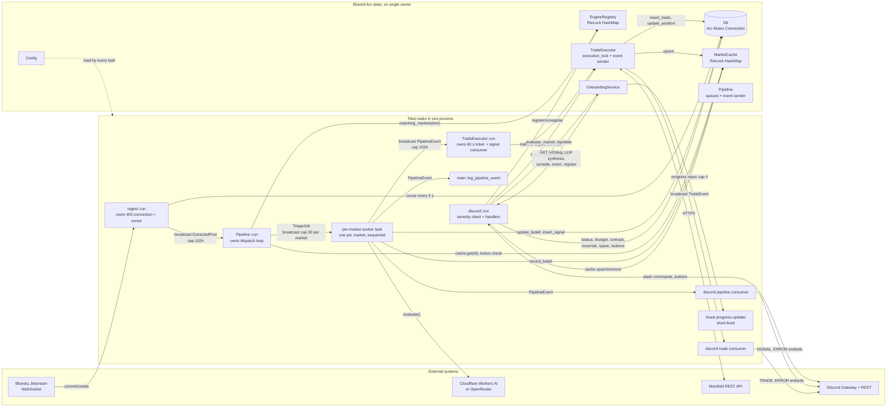
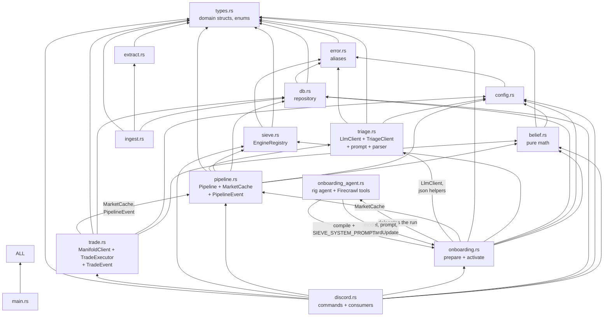
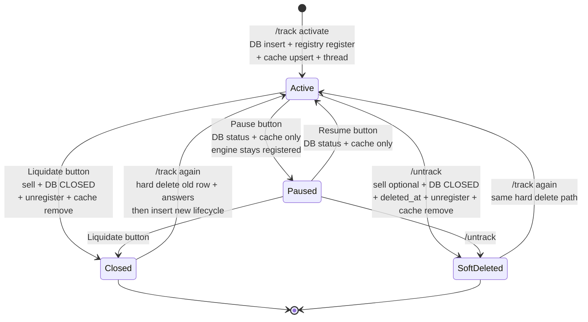
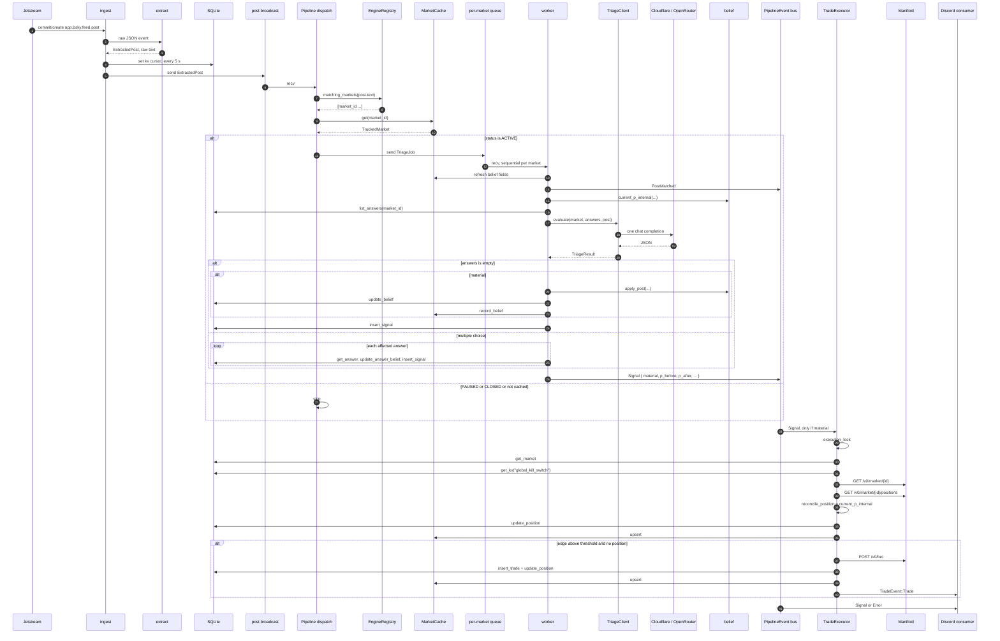
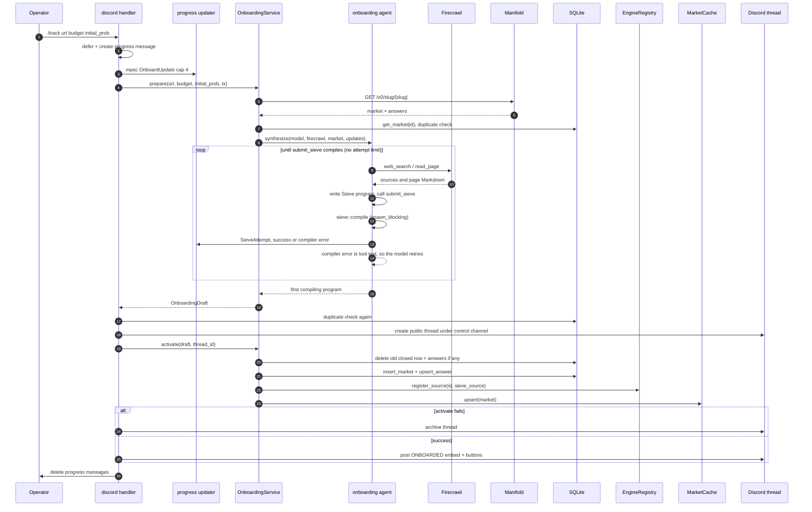
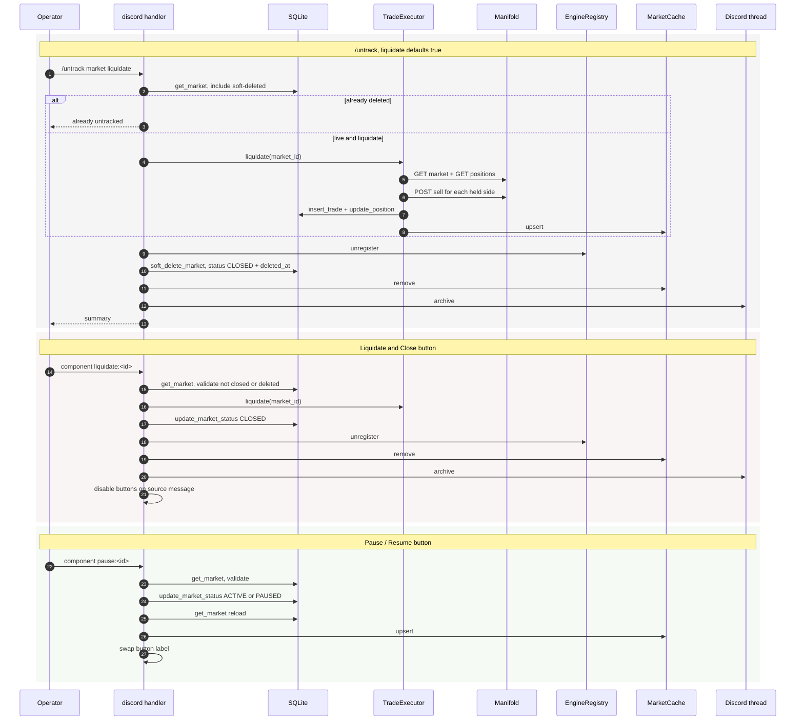
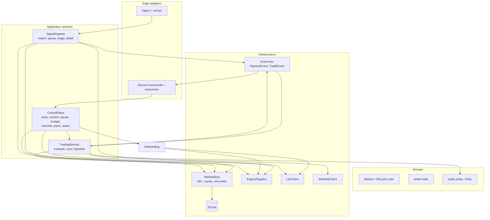

# Architecture map — detailed enough to plan a restructure

This describes the code as it is **today**. Each box maps to a Rust module. Each
arrow is a real call or channel. Line references point to the current source.

---

## 1. Runtime topology: tasks, shared state, channels



Key point for restructuring: there is **no single composition root object** after
`main.rs`. Shared state is a set of independent `Arc`s passed into constructors.
Any module can hold any other module's state.

### Task inventory

| Task | Spawned in | Lifetime | Owns | Ends when |
|---|---|---|---|---|
| `ingest::run` | `main.rs:144` | process | WS stream, cursor tracker, `post_tx` | Ctrl-C (`abort`) |
| `Pipeline::run` | `main.rs:126` | process | `post_rx`, dispatch loop | Ctrl-C |
| per-market worker | `pipeline.rs:433`, lazily | process, detached | `TriageJob` receiver, queue depth | sender dropped / Ctrl-C |
| `TradeExecutor::run` | `main.rs:135` | process | pipeline event receiver, 60 s ticker | Ctrl-C |
| `discord::run` | `main.rs:150` | process | gateway client, handlers | gateway error / Ctrl-C |
| pipeline consumer | `discord.rs:115` | process | `PipelineEvent` receiver | channel closed |
| trade consumer | `discord.rs:121` | process | `TradeEvent` receiver | channel closed |
| logger | `main.rs:158` | process | `PipelineEvent` receiver | channel closed |
| `/track` updater | `discord.rs:717` | one command | `OnboardUpdate` receiver, progress message | sender dropped |

---

## 2. Module dependency graph: who imports whom



### Dependency observations that matter for restructuring

1. **No module cycles.** The graph is acyclic. `pipeline` does not import `trade`,
   and `trade` does not import `discord`. This is good news: you can split modules
   without breaking a cycle.
2. **`pipeline.rs` is three modules in one file.** It contains:
   - `MarketCache` — a state store used by `trade`, `onboarding`, `discord`, `main`.
   - `Pipeline` — orchestration and per-market queues.
   - `PipelineEvent` — the event API used by `trade`, `discord`, `main`.

   That is why `trade.rs` and `onboarding.rs` import `pipeline`. They want a cache
   and an event type, not the orchestration.
3. **`trade.rs` has two entry points.** It consumes `PipelineEvent` in `run()` and
   exposes `evaluate_market()`, `sync_market()`, `liquidate()`, `liquidate_all()`
   directly to Discord. It is both a subscriber and a service.
4. **`onboarding.rs` reaches into `triage.rs`** for `LlmClient` and `snippet`.
   LLM transport is coupled to the triage feature.
   `onboarding.rs` and `onboarding_agent.rs` form one deliberate pair: the
   service prepares and activates a draft and delegates the model run, while the
   agent owns the tools and imports the prompt, market type, and progress events
   from the service. The import edge goes both ways, but it is one workflow, not
   two features.
5. **`discord.rs` has the widest fan-in** (7 internal modules). Every command
   handler orchestrates DB + cache + registry + trade + onboarding by hand.
6. **`types.rs` is a shared kernel.** All modules depend on it, and it contains both
   pure domain values (`TrackedMarket`, `Direction`) and workflow payloads
   (`TriageResult`, `TradeDecision`, `SignalRecord`). This is acceptable, but a
   change to a ledger struct touches many modules.

---

## 3. State ownership and sources of truth

This is the most important section for restructuring. Several facts live in
**two or three places at once**.

| Fact | Authoritative store | Mirrors | Writers | Readers |
|---|---|---|---|---|
| Market lifecycle `status` | `tracked_markets.status` | `MarketCache` entry | onboarding.activate, `/budget`, `/override`, Pause button, `/untrack`, Liquidate button, trade.persist_market | dispatch, trade, `/status`, autocomplete |
| Presence of a Sieve engine | `EngineRegistry` map | none | `main` startup, onboarding.activate, `/untrack`, Liquidate button | dispatch |
| Compiled rule text | `tracked_markets.sieve_source` | none | onboarding.activate | `/status` embed |
| Budget / invested / PnL / shares | `tracked_markets` | `MarketCache` | trade (position), `/budget`, onboarding | trade, `/status` |
| Belief `p_internal_log_odds`, `belief_updated_at` | `tracked_markets` and `market_answers` | `MarketCache` (market only) | pipeline worker, `/override`, onboarding | pipeline, trade, `/status` |
| Market price `p_market_last` | Manifold `/v0/market` | `tracked_markets` + cache | trade.sync / evaluate | triage prompt, trade, `/status` |
| Position truth | Manifold `/v0/market/{id}/positions` | local shares + invested | trade.reconcile | trade, `/status` |
| Global kill switch | `kv.global_kill_switch` | none | `/panic` | trade.evaluate_market |
| Signal history | `signal_ledger` | none | pipeline worker | `/status` |
| Trade history | `trade_ledger` | none | trade | `/status` |
| Discord thread per market | `tracked_markets.discord_thread_id` | none | onboarding.activate (via `/track`) | embed consumers, `/untrack`, Liquidate |
| In-flight triage count | `QueueDepth` AtomicUsize | none | pipeline enqueue/dequeue | `/status` |

### Lifecycle state machine (three stores must agree)



Rules encoded only by convention, not by a type:

- A **paused** market keeps its engine. `dispatch` matches it, then skips it because
  the cache says `PAUSED` (`pipeline.rs:353-358`). So "registered" does not mean
  "live".
- A **closed** market may or may not have `deleted_at`. `/untrack` sets both. The
  Liquidate button sets `CLOSED` only. `list_markets` hides only soft deletes, so a
  closed-but-tracked market still appears in `/status` and autocomplete.
- Re-`/track` on a `CLOSED` row hard-deletes the row and answers, then inserts a new
  one. The ledgers keep the old history.
- Position reconciliation can change shares/invested **without** a trade.
  `sync_market` writes them from Manifold every 60 s.

### Multi-step writes with no shared transaction

| Operation | Steps | Failure handling |
|---|---|---|
| `onboarding.activate` (`onboarding.rs:320`) | delete old closed row + answers → insert market → insert answers → register engine → cache upsert | manual rollback of DB row, answers, engine; cache is not rolled back if `upsert` fails |
| `/track` (`discord.rs:845`) | prepare (read only) → create Discord thread → activate → post embed | archive thread if activate fails; post failure is logged only |
| `/untrack` (`discord.rs:947`) | resolve row → liquidate → unregister → soft delete → cache remove → archive thread | liquidation error aborts before cleanup; archive failure is logged only |
| Liquidate button (`discord.rs:1507`) | check status → `executor.liquidate` → DB CLOSED → unregister → cache remove → archive thread → disable buttons | each cleanup step is best effort; a sell error still closes the market |
| Pause button (`discord.rs:1390`) | read row → validate → DB status → reload → cache upsert → edit buttons | DB and cache can diverge if reload/upsert fails |
| `/override` (`discord.rs:1054`) | compute logit → DB update → reload → cache upsert → spawn trade check | trade check is fire-and-forget; errors are logged only |

These are the main **consistency seams**. Any restructure should decide whether
these become a single `MarketService` transaction, or stay as sagas with explicit
compensation.

---

## 4. Interface contracts

The current public API, grouped by module. These are the seams you can move.

### `db.rs`

```rust
#[derive(Clone)]
pub struct Db { conn: Arc<Mutex<Connection>> }

Db::open(path) -> AppResult<Db>
Db::open_in_memory() -> AppResult<Db>

Db::insert_market(&TrackedMarket)
Db::get_market(id) -> Option<TrackedMarket>          // includes soft-deleted
Db::list_markets() -> Vec<TrackedMarket>             // excludes soft-deleted
Db::list_markets_including_deleted()
Db::list_markets_by_status(status) -> Vec<TrackedMarket>
Db::update_market_status(id, status)
Db::update_budget(id, budget)
Db::update_belief(id, log_odds, p_market, updated_at)
Db::update_position(id, invested, realized_pnl, yes_shares, no_shares)
Db::set_thread_id(id, thread_id)
Db::delete_market(id) / soft_delete_market(id, deleted_at)

Db::insert_signal(&SignalRecord) -> i64
Db::recent_signals(id, limit) / latest_signal_time(id)
Db::insert_trade(&TradeRecord) -> i64 / recent_trades(id, limit)

Db::upsert_answer(&TrackedAnswer) / list_answers(id) / get_answer(market_id, id)
Db::update_answer_belief(...) / update_answer_shares(...)
Db::delete_answers_for_market(id)

Db::get_kv(key) / set_kv(key, value) / delete_kv(key)
```

All calls are **synchronous** and hold the single connection mutex. Callers use
them from async tasks but never hold the guard across `.await`.

### `sieve.rs`

```rust
pub struct EngineRegistry { engines: RwLock<HashMap<MarketId, CompiledSieve>> }

EngineRegistry::new()
register(id, CompiledSieve)
register_source(id, &str) -> AppResult<()>   // compiles then inserts
unregister(id) -> bool
matching_markets(text) -> Vec<MarketId>
market_ids() / len() / is_empty() / contains(id)
sieve::compile(source) -> AppResult<CompiledSieve>
```

### `belief.rs`

Pure functions, no I/O:

```rust
current_p_internal(l_stored, updated_at, p_market, now, halflife) -> f64
apply_post(&mut l_stored, &mut updated_at, direction, strength, p_market, now, kappa, halflife) -> impulse
sigmoid(log_odds) / logit(p) / override_probability(p) -> (log_odds, p)
```

### `triage.rs`

```rust
pub struct LlmClient { cloudflare: Option<...>, openrouter: Option<...> }

LlmClient::new() -> AppResult<Self>              // reads env through rig providers
LlmClient::complete(model, system, user) -> String
LlmClient::completion_model(model) -> rig::DynModel<rig::operation::Completion>

pub struct TriageClient { client: LlmClient, model: String }

TriageClient::new(&Config)
TriageClient::evaluate(
    &TrackedMarket,
    &[TrackedAnswer],
    &ExtractedPost,
    Option<&str>,          // currently always None
    p_market: f64,
) -> AppResult<TriageResult>

build_prompt(...) / build_multiple_choice_prompt(...)
parse_triage_response(raw) -> TriageResult
is_material(&TriageResult) -> bool
```

`TriageClient` is a thin feature wrapper. The reusable LLM transport is
`LlmClient`. Triage uses `complete`; onboarding passes `completion_model` to the
`rig` agent builder in `onboarding_agent.rs`.

### `pipeline.rs`

```rust
pub struct MarketCache { markets: RwLock<HashMap<MarketId, TrackedMarket>> }

MarketCache::load(&Db) / get(id) / active_markets() / active_count()
upsert(TrackedMarket) / remove(id) / reload(&Db)
// private record_belief(id, log_odds, p_market, updated_at)

pub enum PipelineEvent {
    PostMatched { market_id, post_uri, author_handle },
    Signal { market_id, question, post_uri, author_handle, author_did,
             text, direction, strength, rationale, material,
             impulse, p_before, p_after, p_market, created_at },
    Error { market_id: Option<MarketId>, message },
}

pub struct Pipeline {
    config: Arc<Config>, db: Db, registry: Arc<EngineRegistry>,
    cache: Arc<MarketCache>, triage: TriageClient,
    events: broadcast::Sender<PipelineEvent>,
    queues: Mutex<HashMap<MarketId, QueueHandle>>,
    processed_posts: AtomicU64,
}

Pipeline::new(config, db, registry, cache) -> Self
events() -> broadcast::Sender<PipelineEvent>
queue_depth(id) / queue_depths() / processed_posts()
run(self: Arc<Self>, posts: broadcast::Receiver<ExtractedPost>)
```

Private per-market machinery: `TriageJob`, `QueueHandle`, `QueueDepth`,
`spawn_worker`, `worker_loop`, `process`, `dispatch`, `enqueue`.

### `trade.rs`

```rust
pub struct ManifoldClient { ... }
ManifoldClient::new(&Config).await -> AppResult<Self>   // resolves GET /v0/me
bot_user_id() -> &str
market(id) -> MarketSnapshot
position(id) -> PositionSnapshot
buy(id, outcome, amount, answer_id) -> BetResult
sell(id, outcome, shares, answer_id) -> BetResult
bets(id) -> Vec<Value>

pub fn kelly_target_mana(...)
pub fn decide_trade(&TrackedMarket, p_internal, p_market, TradeParams) -> Option<TradeDecision>
pub fn decide_trade_for_answer(...)                     // multi-choice path
pub fn apply_buy(&mut TrackedMarket, TradeAction, cost, shares)
pub fn apply_sell(&mut TrackedMarket, TradeAction, shares, proceeds)

pub enum TradeEvent {
    Trade { market_id, action, mana_amount, shares_delta,
            p_internal, p_market, available_budget, bet_id },
    Error { market_id, message },
}

pub struct TradeExecutor {
    client: ManifoldClient, db: Db, cache: Arc<MarketCache>,
    params: TradeParams, halflife_hours: f64,
    execution_lock: tokio::sync::Mutex<()>,
    events: broadcast::Sender<TradeEvent>,
}

TradeExecutor::new(&Config, Db, Arc<MarketCache>).await
events() / client()
evaluate_market(market_id, trigger_post_uri) -> Option<TradeRecord>
sync_market(market_id) -> TrackedMarket
sync_all() -> Vec<(MarketId, Error)>
liquidate(market_id) -> LiquidationOutcome
liquidate_all() -> Vec<(MarketId, Error)>
run(self: Arc<Self>, broadcast::Receiver<PipelineEvent>)
```

`evaluate_market` does a full remote round trip on **every** material signal:
`GET market` + `GET positions` + optional `POST bet/sell` + DB writes. It
serializes all markets on one `execution_lock`.

### `onboarding.rs`

```rust
OnboardingService::new(&Config, Db, Arc<EngineRegistry>, Arc<MarketCache>)

prepare(url, budget, initial_prob, &mpsc::Sender<OnboardUpdate>)
    -> AppResult<OnboardingDraft>          // read only: Manifold + agent + compile
activate(draft, thread_id)
    -> AppResult<TrackedMarket>            // DB + answers + engine + cache
```

`OnboardingDraft { market, sieve_source, answers }`. The split exists only because
Discord must create the thread between the two calls.

### `onboarding_agent.rs`

```rust
MAX_AGENT_TURNS: usize = 200             // runaway guard, not an attempt limit
synthesize(model, Arc<firecrawl::Client>, &ManifoldSlugMarket, &mpsc::Sender<OnboardUpdate>)
    -> AppResult<String>                 // the first program that compiled
```

`synthesize` builds one `rig` agent with the `SIEVE_SYSTEM_PROMPT` plus the agent
instructions, three `DynamicTool`s, and `default_max_turns(MAX_AGENT_TURNS)`:

- `submit_sieve` compiles a program with `spawn_blocking` (Cranelift is CPU-bound
  and `CompiledSieve` is `!Send`). It records the first program that compiles in
  a shared slot and reports every submission as `OnboardUpdate::Sieve`. There is
  no attempt limit; a compile error goes back to the model as tool text.
- `web_search` calls Firecrawl `/search` over web and news.
- `read_page` calls Firecrawl `/scrape` in Markdown mode and truncates the page
  to 20,000 characters.

The agent's final text is ignored; the accepted program comes from the slot. If
the run ends with an empty slot, the error carries the last compiler error.

### `discord.rs`

```rust
pub struct DiscordState {
    config: Arc<Config>, db: Db, registry: Arc<EngineRegistry>,
    cache: Arc<MarketCache>, pipeline: Arc<Pipeline>,
    onboarding: Arc<OnboardingService>, executor: Arc<TradeExecutor>,
}

discord::run(state, pipeline_events, trade_events) -> AppResult<()>
```

Handlers are private functions. Each does its own orchestration: `track`,
`untrack`, `budget`, `status`, `override_belief`, `panic_mode`, `pause_button`,
`liquidate_button`, `autocomplete`.

### `ingest.rs` / `extract.rs`

```rust
ingest::channel() -> broadcast::Sender<ExtractedPost>   // cap 1024
ingest::run(Config, Db, broadcast::Sender<ExtractedPost>) -> AppResult<()>
extract::extract(&serde_json::Value) -> Option<ExtractedPost>
```

`extract` performs structural extraction only. It never normalizes text.

---

## 5. End-to-end sequences

### 5.1 One post through the data path



### 5.2 `/track` (three-phase transaction across layers)



### 5.3 `/untrack`, Liquidate button, Pause button



Note: the Liquidate button leaves `deleted_at = NULL`, so the closed row still
appears in `/status`. `/untrack` sets `deleted_at` and hides the row. These are
**different** end states that are easy to confuse during a refactor.

---

## 6. Communication contract details

| Link | Mechanism | Capacity / policy | Failure behavior |
|---|---|---|---|
| ingest → pipeline | `broadcast<ExtractedPost>` | 1024, drop oldest, receiver sees `Lagged` | pipeline logs and skips dropped posts |
| pipeline → worker | `broadcast<TriageJob>` per market | 30, drop oldest, depth corrected on `Lagged` | warn rate-limited to 1 per 30 s per market |
| pipeline → trade/discord/logger | `broadcast<PipelineEvent>` | 1024, drop oldest | trade logs skipped signals; a skipped material signal is **not** retried |
| trade → discord | `broadcast<TradeEvent>` | small, drop oldest | only Discord consumes it |
| onboarding → `/track` reply | `mpsc<OnboardUpdate>` | 4 | updater never blocks synthesis; edit failures are logged |
| Discord → services | direct async calls | none | command handlers catch errors and reply |
| services → SQLite | `Arc<Mutex<Connection>>` | one connection, WAL | busy timeout 5 s; poisoned mutex returns an error |
| trade state changes | `tokio::sync::Mutex<()>` | one at a time | serializes evaluate/sync/liquidate across all markets |
| registry / cache | `std::sync::RwLock` | short critical sections | poison recovered by `into_inner` |

Properties to preserve:

- `broadcast` has **no history**. `main.rs` subscribes all receivers before
  spawning tasks. A late subscriber misses events.
- No event is persisted. A restart loses in-flight signals. The 60 s `sync_all`
  recovers position and price, not missed signals.
- Every channel is bounded. The design prefers dropping data to blocking the
  firehose.

---

## 7. Restructuring hotspots and candidate seams

Ordered by expected payoff. Each item states what exists, why it hurts, and a safe
cut.

### A. `MarketCache` lives in `pipeline.rs` but is used everywhere

**Today:** `trade`, `onboarding`, `discord`, and `main` import `pipeline::MarketCache`.
`pipeline` also owns the queues and event bus.

**Why it hurts:** a cache change forces a rebuild of the orchestrator's module. The
cache has no owner: four modules call `upsert`/`remove` and can write stale
snapshots.

**Candidate cut:** create `store.rs` or `market_state.rs` that owns:

- `MarketCache`
- the invariant "DB row and cache agree"
- methods like `update_budget`, `set_status`, `record_belief`, `record_position`,
  `remove`

Then `pipeline`, `trade`, `discord`, and `onboarding` depend on `MarketState`, not
on `Pipeline`. `PipelineEvent` moves to `events.rs` or `types.rs`, which removes the
`trade → pipeline` and `onboarding → pipeline` edges entirely.

### B. Three sources of truth for "is this market live"

**Today:** DB status + cache entry + registry membership. Pause touches two, untrack
touches three, and dispatch re-checks the cache.

**Why it hurts:** a bug in any writer produces a market that matches but does not
trade, or trades but is not visible, or has no Discord thread.

**Candidate cut:** a single `MarketLifecycle` service with explicit transitions:

```rust
activate(draft, thread_id)
pause(id) / resume(id)
close(id)             // no deletion, row visible
untrack(id)           // close + soft delete
```

Each transition updates DB, cache, and registry in one place, with a documented
compensation order. Keep `EngineRegistry` internal to this service so callers cannot
forget to unregister.

### C. Discord handlers are orchestrators

**Today:** `untrack_market`, `liquidate_market`, `pause_button`, `budget`,
`override_belief` each combine DB reads/writes, cache reloads, registry changes,
executor calls, thread archiving, and embed edits. `untrack_market` and
`liquidate_market` duplicate most of the teardown.

**Why it hurts:** the same lifecycle transition exists twice with different end
states. Testing requires a Discord mock.

**Candidate cut:** introduce a `ControlPlane` service (or `MarketService`) with
intention-revealing methods that return a plain report struct:

```rust
track(url, budget, initial_prob) -> TrackResult
untrack(query, liquidate) -> UntrackResult
set_budget(query, amount) -> BudgetResult
set_probability(query, p) -> OverrideResult
set_paused(id, paused) -> StatusResult
panic(liquidate_all) -> PanicResult
status(query) -> StatusReport
```

Discord then only parses options, calls one method, and renders the result. Thread
creation/archiving needs a small port (`ThreadProvisioner`) because it is a Discord
concern, but the *ordering* stays in the service.

### D. `/track` is split by a UI constraint

**Today:** `prepare` is read-only, then Discord creates a thread, then `activate`
writes. That split exists because no market should go live without a thread.

**Why it hurts:** the transaction spans two modules plus the Discord API. Partial
failure needs manual thread archiving.

**Candidate cut:** keep the split, but make it explicit:

- `prepare` returns a `PreparedMarket` value.
- `activate(prepared, thread_id)` is the only writer.
- A small `onboard_market` orchestrator in the control-plane service creates the
  thread and compensates.

Do **not** merge prepare and activate unless you accept a market row without a
thread.

### E. `trade.rs` is both a consumer and a service, and depends on the pipeline event type

**Today:** `TradeExecutor::run` selects on `PipelineEvent`; Discord calls
`evaluate_market`/`liquidate` directly. One `execution_lock` serializes all markets.

**Why it hurts:** the trade layer cannot be tested or reused without the pipeline's
event enum. The global lock also means one slow Manifold call delays every market.

**Candidate cut:**

- Define `SignalReady { market_id, post_uri }` as a small trade-facing command type.
  The event adapter lives in `pipeline`.
- Keep one lock per market (`Mutex<()>` in a map) instead of one global lock, if you
  want market-level concurrency.
- Split `ManifoldClient` (transport) from `TradeExecutor` (policy and persistence).
  The client is already close to that split.

### F. `LlmClient` sits inside `triage.rs`

**Today:** `onboarding` imports `LlmClient`, `extract_json_object`, and `snippet`
from `triage`.

**Why it hurts:** LLM transport is a shared infrastructure concern, but it is named
after one feature.

**Candidate cut:** `llm.rs` holds `LlmClient` + JSON helpers. `triage.rs` keeps the
prompt, model choice, `TriageResult` parsing, and `is_material`. `onboarding.rs`
keeps the Sieve prompt and compile loop. This makes the dependency direction clean:
`triage → llm`, `onboarding → llm`.

### G. Event payloads are the de facto API

**Today:** `PipelineEvent::Signal` carries 17 fields, including display strings
(`question`, `text`, `rationale`) and numbers. `TradeEvent::Trade` carries 8 fields.
Discord renders them directly.

**Why it hurts:** any change to an embed needs a change to the pipeline event. The
event mixes domain facts and presentation inputs.

**Candidate cut:** keep events as domain facts (`market_id`, `post_uri`,
`direction`, `strength`, `p_before`, `p_after`, `material`) and let the Discord
consumer look up `question`/`text` from the DB or a small view model. This also
shrinks the broadcast message and avoids duplicating large post text on the bus.

Trade-off: an extra DB read per embed. At this volume that is cheap.

### H. Synchronous `Db` calls inside async tasks

**Today:** one `Arc<Mutex<Connection>>` shared by all tasks. Every call blocks the
executor thread for the duration of a short query.

**Why it hurts:** WAL + short queries make this acceptable now. It becomes a problem
if you add concurrent workers or long queries.

**Candidate cut (only if needed):** a small `tokio::task::spawn_blocking` wrapper or
a connection pool (`r2d2_sqlite`). Do **not** do this as part of a pure module
refactor; it changes failure and latency behavior.

### I. Multi-choice is a separate path

**Today:** `pipeline::process` branches on `answers.is_empty()`. The multi-choice
branch updates each answer, writes one signal per answer, and emits a market-level
`Signal` with `impulse = 0` and `p_after = p_before`. `trade` has
`decide_trade_for_answer`. Discord's `/override` only handles the market-level
belief.

**Why it hurts:** two belief models and two event semantics live in one function. A
refactor can silently break one.

**Candidate cut:** make the triage outcome an enum:

```rust
enum Triaged {
    Market { direction, strength, impulse, p_after },
    Answers(Vec<AnswerUpdate>),
}
```

Then one branch applies it. Keep the market-level `Signal` for display, or emit a
distinct `AnswerSignal` if Discord needs it.

### J. `main.rs` is a manual composition root

**Today:** `main.rs` builds every `Arc`, wires every constructor, subscribes four
receivers in a specific order, and spawns five tasks. The ordering comments are
load-bearing.

**Why it hurts:** adding a module means editing `main.rs` in several places, and the
subscribe-before-spawn rule is easy to break.

**Candidate cut:** an `App`/`Runtime` struct with `App::build(config, db) -> App` and
`App::spawn() -> Tasks`. Keep the same order inside it, but encode the rule once.
This is a low-risk, high-clarity change.

---

## 8. Suggested target decomposition (still one binary, one runtime)



If you make only three cuts, make these:

1. **Move `MarketCache` out of `pipeline`** and give it a single writer
   (`MarketStore`). This removes the `trade → pipeline` and `onboarding → pipeline`
   dependencies.
2. **Move lifecycle transitions into one service** so DB, cache, and registry
   cannot disagree. This removes duplicated teardown in Discord.
3. **Move `LlmClient` into `llm.rs`** so triage and onboarding are peers, not parent
   and child.

Preserve these invariants during any move (they are behavioral, not structural):

- One binary, one tokio runtime, no extra services.
- Sieve in-process; one LLM call per surviving post.
- `extract` never normalizes text.
- Per-market budget invariant: `invested <= budget + realized_pnl`.
- Manifold `/positions` is the position truth; `/v0/me` is the bot identity.
- Cloudflare calls go through the vendored `rig` `/ai/run` provider.
- A paused market keeps its engine; dispatch skips it by status.
- `/untrack` soft-deletes; Liquidate closes but keeps the row visible.
